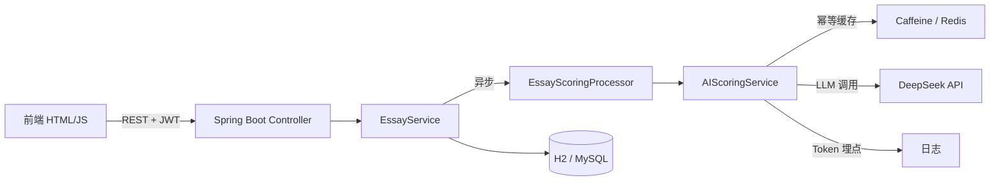

# 📝 智能作文评分与反馈系统

基于 **Spring Boot 3 + DeepSeek 大模型** 的智能作文评分系统，支持 AI 自动评分、多维度分析、结构化反馈生成，学生端和教师端分离。

> **English**: An AI-powered essay scoring and feedback system built on Spring Boot + DeepSeek. Scores essays across four dimensions, generates structured feedback, and supports async scoring (PENDING → SCORING → SUCCESS/FAILED), idempotent caching, and token metering. The backend is security-audited (4 auth vulnerabilities fixed) and covered by a 32-case offline LLM evaluation suite.

## ✨ 核心功能

| 学生端 | 教师端 |
|--------|--------|
| 提交作文（文本输入/粘贴） | 查看所有学生作文 |
| 选择年级和文体类型 | 管理评分规则和权重 |
| AI 四维度自动评分 | 手动调整评分 |
| 雷达图可视化 | 统计分析（篇数/人数/均分） |
| 智能反馈（语法/表达/结构建议） | 启用/禁用评分规则 |

## 🏗️ 技术栈

| 层级 | 技术 |
|------|------|
| 后端框架 | Spring Boot 3.0.2 |
| 安全认证 | Spring Security + JWT + BCrypt |
| 数据库 | H2（开发）/ MySQL（生产） |
| 缓存 | Caffeine（本地）/ Redis（生产，预留） |
| AI 引擎 | DeepSeek API（OpenAI 兼容接口） |
| 前端 | HTML5 + CSS3 + Chart.js（原生 JS） |
| 构建工具 | Maven / Docker |

## 🧭 架构



## 🚀 快速启动

### 环境要求
- JDK 17+
- Maven 3.6+

### 3 步运行（本地开发）

```bash
# 1. 生成并设置 JWT_SECRET（Base64，≥32 字节，必须）
python -c "import os,base64;print(base64.b64encode(os.urandom(48)).decode())"
# Windows PowerShell:
$env:JWT_SECRET='<上面生成的值>'

# 2. 本地开发用 dev profile（开启 H2 控制台 + Mock 降级 + ddl-auto:update）
$env:SPRING_PROFILES_ACTIVE='dev'

# 3. 编译并启动
cd "Essay Scoring"
mvn spring-boot:run
```

访问：
- 登录页：http://localhost:8080/index.html
- 学生端：http://localhost:8080/student.html
- 教师端：http://localhost:8080/teacher.html

> ⚠️ **环境变量说明**：
> - `JWT_SECRET` **必须配置**（启动时校验，缺失直接拒绝启动）。
> - `DEEPSEEK_API_KEY` 非 dev 环境**必须配置**，否则启动失败（fail-fast）；仅 dev/test profile 允许 Mock 降级返回模拟评分。
> - 生产环境请用默认 profile（`ddl-auto:validate` + H2 关闭），并配合 Flyway 建表。

### 演示账号（DataInitializer 自动创建）

| 用户名 | 密码 | 角色 |
|--------|------|------|
| `student1` | `123456` | 学生 |
| `teacher1` | `123456` | 教师 |

## 📊 评分维度

| 维度 | 满分 | 评估内容 |
|------|------|----------|
| 内容 | 30 分 | 主题明确、内容充实、观点正确 |
| 结构 | 25 分 | 层次清晰、逻辑严密、结构完整 |
| 语言 | 25 分 | 表达准确、用词恰当、语句流畅 |
| 创意 | 20 分 | 立意新颖、角度独特、富有想象力 |

## 🛡️ 工程实践与量化

- **代码审计**：完成一次完整安全审计，修复权限提升、IDOR 越权、H2 控制台未授权访问、JWT 异常处理 4 类安全漏洞，以及事务边界不当导致的连接池耗尽缺陷。
- **LLM 打桩评测集**：32 条离线评测样本（正常评分 / 分数越界裁剪 / 字段缺失 / feedbacks 校验 / JSON 提取 / 异常降级 / 截断重试），Mockito 打桩 ChatClient，可在 CI 中稳定回归，无需真实 API Key。
- **评分异步化**：提交即返回，后台异步评分，状态机 PENDING → SCORING → SUCCESS / FAILED。
- **幂等缓存**：基于作文内容 hash 的幂等 Key，同一篇作文不重复调用模型。
- **Token 埋点**：解析 DeepSeek 响应的 usage，记录 prompt / completion / total token。

## 🔒 安全配置

敏感信息通过环境变量管理：

| 环境变量 | 说明 |
|----------|------|
| `JWT_SECRET` | JWT 签名密钥（Base64，≥32 字节，**必须**） |
| `DEEPSEEK_API_KEY` | DeepSeek API 密钥（非 dev 必须） |
| `DB_PASSWORD` | 数据库密码（生产必须） |
| `CORS_ORIGINS` | 允许的前端来源 |

## 📁 项目结构

```
essay-scoring-system/
├── Essay Scoring/              # 主项目
│   ├── src/main/java/.../      # Java 源码
│   │   ├── config/             # Security、JWT、AI 配置
│   │   ├── controller/         # Auth、Student、Teacher API
│   │   ├── service/            # AI 评分、作文管理、异步处理器、规则服务
│   │   ├── entity/             # JPA 实体（含评分状态机）
│   │   ├── repository/         # Repository
│   │   ├── dto/                # 请求/响应 DTO
│   │   └── exception/          # 领域异常
│   ├── src/main/resources/
│   │   ├── application.yml     # 生产配置
│   │   ├── application-dev.yml # 开发配置
│   │   └── static/             # 前端页面
│   ├── src/test/               # 评测集测试（32 条）
│   ├── Dockerfile              # 多阶段构建
│   ├── docker-compose.yml      # app + redis
│   ├── 启动指南.md
│   ├── 快速启动指南.md
│   └── pom.xml
└── README.md                   # 本文件
```

## 📄 许可证

MIT License
